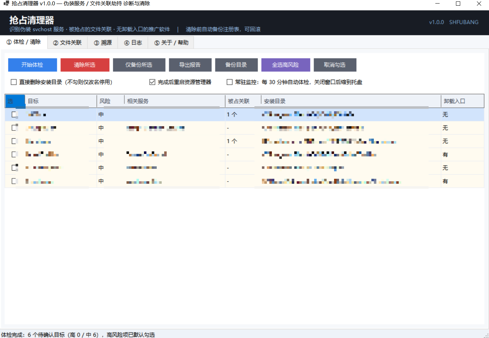

# 抢占清理器

Windows 上那些删不掉的软件、抢不回来的文件关联，用它收拾。

## 能做的

- 扫一遍，列出可疑的软件，标风险档和有没有卸载入口
- 清理：停服务、结束进程、清掉它抢走的关联、目录改名停用
- 把被抢走的扩展名指回系统自带或你装的软件
- 从浏览器历史里翻出它是哪天下载、哪天装的
- 全程记日志，能导出
- 常驻监控，半小时自己查一遍，有事弹托盘
- 命令行跑一遍直接出报告：`抢占清理器.exe --scan-report D:\报告.txt`
- 中英文文档

## 跑起来

Windows 10 / 11 64 位，装 .NET 8 Desktop Runtime。解压双击，第一次会弹 UAC，允许它。

## 授权

免费，个人和公司内部用，不限台数。别反编译、别删署名、别改名再发、别拿去卖。条款在 [LICENSE](LICENSE)。

商业授权、定制、批量部署：黎工搞工控[foxlim]，foxlim@163.com

它真的会删东西，用之前看一下要清的是什么。
