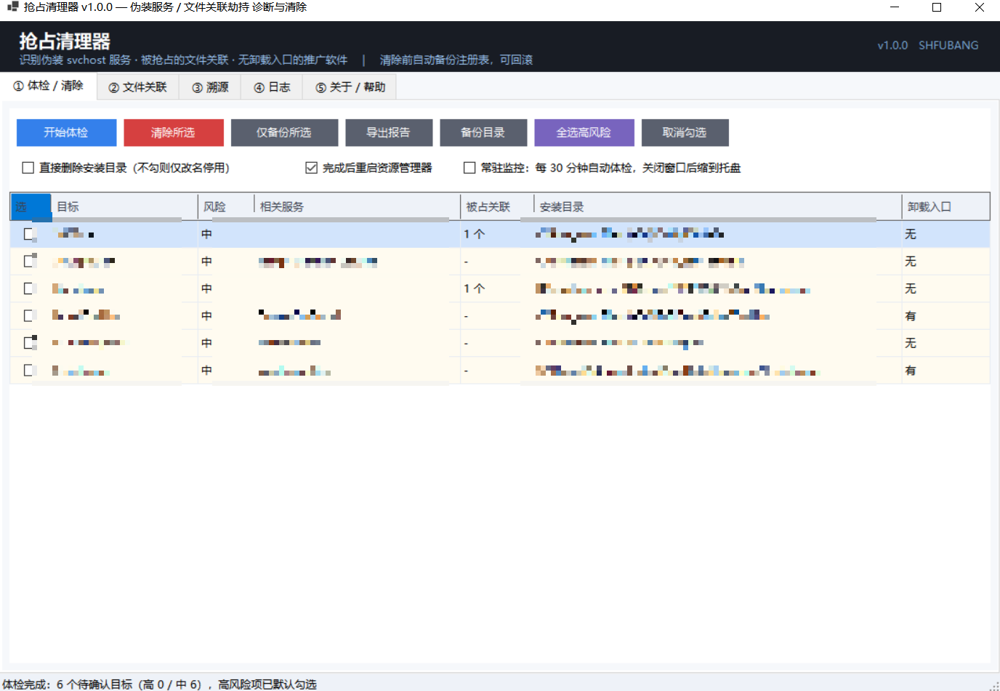

# HijackCleaner

[中文](README.md) · **English**

For the Windows software you can't uninstall and the file associations you can't get back.

## What it does

- Scans and lists suspicious software with a risk level and whether it has an uninstaller
- Cleans up: stops the service, kills the process, removes what it took, renames its folder
- Points hijacked extensions back to the built-in handler or your own archiver
- Traces when it was downloaded and installed from browser history
- Keeps a log you can export
- Optional resident scan every 30 minutes, tray notification
- Headless report: `抢占清理器.exe --scan-report D:\report.txt`
- Chinese and English docs

## Running it

Windows 10/11 x64 with .NET 8 Desktop Runtime. Extract, double-click, allow the UAC prompt.

## License

Free for personal and internal company use, unlimited machines. No reverse engineering, no stripping attribution, no rebranding, no reselling. Terms in [LICENSE](LICENSE).

Commercial licensing, custom work, bulk deployment: 黎工搞工控[foxlim], foxlim@163.com

It does delete things. Check what you're removing first.
